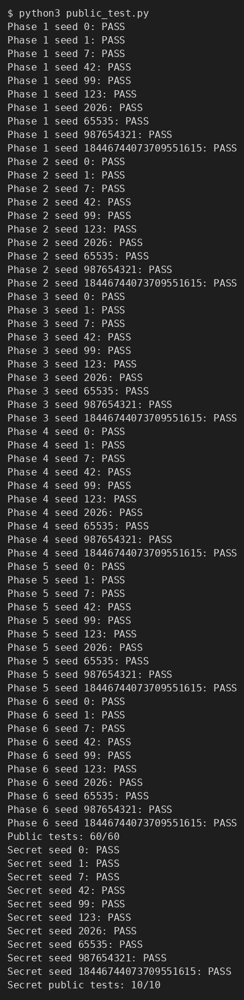
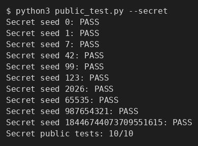
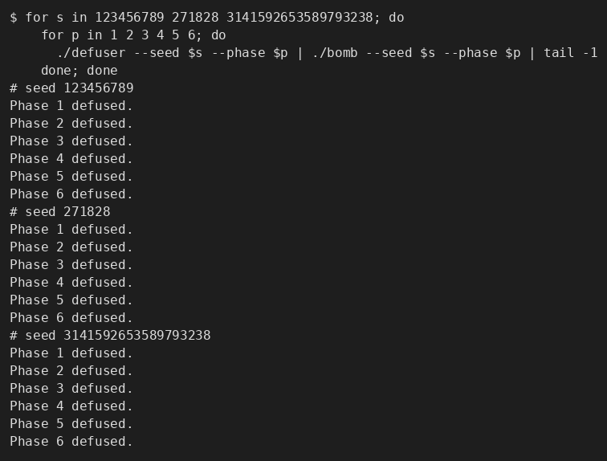
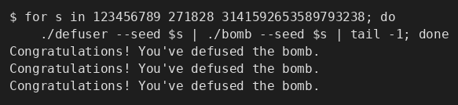

# Lab2 BombLab 实验报告

## 0. 概述

本实验通过阅读个人 `bomb` 的反汇编，还原每一关校验函数的计算关系，并在 `defuser.c` 中实现对应的求解器。每关的口令由 `challenge`（64 位，随 seed 变化）决定，答案不能写死。

- 编译：`make`（`-std=c11 -O2 -Wall -Wextra -Wpedantic -Werror`）
- 个人炸弹：`bomb`（未 strip，带符号名，`nm` 可直接看到 `phase_01`…`phase_06`、`p1_*` 等）
- 结果：`python3 public_test.py` → `Public tests: 60/60`，`Secret public tests: 10/10`

## 使用工具说明

- **反汇编**：`objdump -d --no-show-raw-insn --disassemble=<symbol> bomb`，`objdump -s -j .rodata bomb` 查看常量/表。
- **动态调试**：`gdb`，用于在断点处查看寄存器和内存（未使用 `set` 修改程序内部状态）。
- **辅助 AI 工具**：使用AI工具理解题意和环境搭建，协助解释汇编指令、核对已完成的推理、定位编译/运行错误、排版本报告。分析过程由本人复核，最终代码经本人理解并验证；工具未用于编造分析过程或实验结果。

---

## 第 1 关：函数调用、参数传递、返回值

**关键汇编**（`phase_01`，`0x402090`）：

```asm
40209d: mov  $0x1,%esi              ; valid_u32_fields 的 count = 1
4020aa: call valid_u32_fields
4020ce: call __isoc99_sscanf        ; 格式串 0x403189 = "%u"
4020d8: mov  %r12,%rdi              ; rdi = challenge
4020db: call p1_compute             ; 返回值 eax
4020e0: cmp  %eax,-0x14(%rbp)       ; values[0] == p1_compute(challenge)
4020e3: sete %al
```

`p1_compute`（`0x402050`）把 `challenge` 切片后调用三个 helper：

```asm
402055: mov  %rdi,%rdx        ; rdx = challenge
402058: mov  %rdi,%rax
40205b: shr  $0x20,%rax       ; high = challenge >> 32
40205f: mov  %rdx,%rsi
402064: shr  $0x10,%rsi       ; mid  = challenge >> 16
402062: mov  %eax,%edi
40206b: call p1_step1
402070: mov  %edi,%esi        ; 参数：esi = high
402072: mov  %edx,%edi        ; 参数：edi = low
402074: mov  %eax,%ecx        ; 保存 step1 返回值
402076: call p1_step0
40207b: mov  %ecx,%esi        ; esi = step1 结果
40207d: mov  %eax,%edi        ; edi = step0 结果
40207f: call p1_step2
```

三个 helper：

```asm
p1_step0: lea (%rdi,%rsi,8),%eax ; xor $0x1e2,%eax
p1_step1: xor $0x182c,%esi       ; lea (%rsi,%rdi,4),%eax
p1_step2: lea (%rdi,%rdi,2),%eax ; add %esi,%eax ; xor $0xc08,%eax
```

**恢复的计算关系**（全部 32 位无符号）：

```c
low  = (uint32_t)challenge;
high = (uint32_t)(challenge >> 32);
mid  = (uint32_t)(challenge >> 16);
s1 = (mid ^ 0x182c) + high * 4;          // p1_step1(high, mid)
s0 = (low + high * 8) ^ 0x1e2;           // p1_step0(low, high)
ans = (3 * s0 + s1) ^ 0xc08;             // p1_step2(s0, s1)
```

**推理过程**：`phase_01` 只读 1 个整数并与 `p1_compute` 比较，故答案为一个整数。`p1_compute` 中 `rdi→rdx` 保留低 32 位，`rax=challenge>>32` 为高 32 位，`rsi=challenge>>16` 为中段。易错点是 `p1_step1` 的第二个参数是 `challenge>>16` 而非低 32 位；此外 `mov %eax,%ecx`/`mov %eax,%edi` 读的是刚返回的 helper 结果，不是之前的 `rax`。

**结果**：`Phase 1 defused.`

---

## 第 2 关：数组、循环、递推

**关键汇编**（`phase_02`，`0x4020f0`）：

```asm
4020fd: mov  $0x6,%esi              ; 口令 6 个整数
4020fe: call valid_u32_fields
40214e: call __isoc99_sscanf        ; 格式串 0x40317a = "%u %u %u %u %u %u"
402155: cmp  $0x6,%eax
; 校验 values[0]
40215d: mov  -0x40(%rbp),%esi
402160: shr  $0xf,%rax
402164: and  $0x1f,%eax
402167: lea  (%rax,%rax,2),%eax     ; *3
40216a: cmp  %eax,%esi
; 循环校验 values[1..5]
40216e: mov  $0x1c,%ecx             ; 移位量初值 28，每轮 +5
402173: mov  $0x1,%edx              ; i = 1
402178: mov  %r13,%rax              ; challenge
40217b: shr  %cl,%rax
40217e: and  $0xf,%eax
402181: add  %edx,%eax              ; + i
402183: xor  %esi,%eax              ; ^ 上一个值
402185: mov  -0x40(%rbp,%rdx,4),%esi
402189: lea  (%rax,%rax,2),%eax     ; *3
40218c: cmp  %eax,%esi
402190: add  $0x1,%rdx
402194: add  $0x5,%ecx
402197: cmp  $0x6,%rdx
40219b: jne  402178
```

**恢复的计算关系**：

```c
values[0] = 3 * ((challenge >> 15) & 0x1f);
for (uint32_t i = 1; i < 6; ++i) {
    uint32_t shift = 28 + 5 * (i - 1);
    uint32_t nibble = (challenge >> shift) & 0xf;
    values[i] = 3 * ((nibble + i) ^ values[i-1]);
}
```

**推理过程**：`esi=6` 表明 6 个字段。`values[0]` 单独校验，用位移 15、掩码 `0x1f`。循环中 `ecx` 是移位量（28 起，每轮 +5），`edx` 是下标 `i`，`esi` 保存上一个值，构成一阶递推。

**结果**：`Phase 2 defused.`

---

## 第 3 关：switch 分支与跳转表

**关键汇编**（`phase_03`，`0x4022b0`）：

```asm
4022fc: mov  %r12d,%edi
402301: and  $0x7,%edi              ; idx = challenge & 7
402304: cmp  %edi,-0x18(%rbp)       ; values[0] == idx
402309: mov  %r12,%rax
40230f: shr  $0x3,%rax
402313: shr  $0x20,%rsi
402317: xor  %eax,%esi              ; x = (ch>>32) ^ (ch>>3)
402319: call p3_dispatch
40231e: cmp  %eax,-0x14(%rbp)       ; values[1] == p3_dispatch 结果
```

`p3_dispatch` 用 `idx` 查表跳转：

```asm
402258: cmp  $0x7,%eax
40225b: ja   4022a5                 ; idx > 7 → 返回 0
40225d: notrack jmp *0x405820(,%rax,8)
```

跳转表 `0x405820`（8 个 8 字节指针）经解析后，真实的 `idx → case` 映射为：

| idx | case | 公式 |
| --- | --- | --- |
| 0 | case2 | `(2*x) ^ 0x4099` |
| 1 | case4 | `(x ^ 0x84b0) + (x>>2)` |
| 2 | case6 | `5*x + 0x48a4e` |
| 3 | case7 | `(4*x) ^ 0x6c23` |
| 4 | case0 | `5*x + 0x8de1` |
| 5 | case1 | `5*x + 0x49368` |
| 6 | case5 | `3*x + 0x15c3` |
| 7 | case3 | `(x ^ 0xa012) + (x>>1)` |

**恢复的计算关系**：

```c
uint32_t idx = challenge & 7;
uint32_t x   = (uint32_t)(challenge >> 32) ^ (uint32_t)(challenge >> 3);
// 按上表 switch(idx) 得到 values[1]；values[0] = idx;
```

**推理过程**：`values[0]` 是 `challenge & 7`。表 `0x405820` 存的地址经 `p3_dispatch` 后的若干 `jmp p3_case_x` 桩翻译成实际 case；**关键坑是表是乱序的**（一开始就掉进去了），`idx=k` 并不指向 `p3_case_k`，必须逐项解析表内容。每个 `p3_case` 只做 `lea`/`xor`/`shr` 的 32 位运算。 最终在C中使用`switch`路由到每个case上。

**结果**：`Phase 3 defused.`

---

## 第 4 关：递归调用与返回过程

**关键汇编**（`phase_04`，`0x4023a0`）：

```asm
4023ad: mov  $0x1,%esi
4023ba: call valid_u32_fields        ; 1 个整数
4023e8: mov  %r12,%rcx
4023ee: mov  %r12d,%edi
4023f1: xor  %esi,%esi               ; low = 0
4023f7: shr  $0x7,%rcx
4023fb: and  $0x7f,%edi              ; target = challenge & 0x7f
4023fe: mov  $0x7f,%edx              ; high = 0x7f
402403: xor  %eax,%ecx               ; salt = (ch>>7) ^ (ch>>32)
402405: call p4_walk
40240a: cmp  %eax,-0x14(%rbp)
```

`p4_walk` 实际上就是二分递归查找：

```asm
402334: mov  %edi,%eax               ; target
402336: mov  %edx,%edi
402338: sub  %esi,%edi
40233a: shr  $1,%edi
40233c: add  %esi,%edi               ; mid = low + (high-low)/2
40233e: cmp  %eax,%edi
402340: je   402390                  ; target == mid → 基例
402347: lea  (%rdi,%rcx,1),%ebx      ; ebx = mid + salt
40234e: cmp  %edi,%eax
402350: jb   402370                  ; target < mid
; target > mid：
402352: lea  0x1(%rdi),%esi          ; mid+1
402357: call p4_walk
40235c: lea  (%rax,%rax,4),%eax      ; *5
40235f: xor  %ebx,%eax
402366: xor  $0x11,%eax
; target < mid：对称，先 mid-1，最后 xor $0xb
402390: lea  0x42(%rdi),%eax         ; 基例
402393: xor  %ecx,%eax               ; (mid+0x42) ^ salt
```

**恢复的计算关系**：

```c
uint32_t p4_walk(uint32_t target, uint32_t low, uint32_t high, uint32_t salt) {
    uint32_t mid = low + ((high - low) >> 1);
    if (target == mid) return (mid + 0x42) ^ salt;
    uint32_t e = mid + salt;
    if (target > mid) return ((p4_walk(target, mid + 1, high, salt) * 5) ^ e) ^ 0x11;
    else              return ((p4_walk(target, low, mid - 1, salt) * 5) ^ e) ^ 0xb;
}
```

**推理过程**：`phase_04` 用 `challenge & 0x7f` 作为查找目标、`[0,0x7f]` 为区间、`(ch>>7)^(ch>>32)` 为 salt，调用 `p4_walk`；后者是二分查找，命中返回 `(mid+0x42)^salt`，否则递归并对返回值做 `*5 ^ e ^ (0x11|0xb)`。方向由 `cmp target,mid` + `jb`（无符号）决定。

**结果**：`Phase 4 defused.`

---

## 第 5 关：结构体布局、指针、链表遍历

**结构**：节点 16 字节，`value @+0`、`tag @+4`、`next @+8`。`phase_05` 读 2 个整数，并调用 `p5_traverse(challenge, &tag_out)`。

**关键汇编**（`p5_traverse`，`0x402420`）：

```asm
40242d: and  $0x7,%eax
402434: mov  0x405b60(,%rax,8),%rdx   ; heads[challenge & 7]
402443: shr  $0x6,%rax
402447: xor  %edi,%eax                ; (ch>>6) ^ (ch>>32)
40244e: xor  $0x2e3d,%eax
402453: lea  (%rax,%rax,2),%eax       ; *3
402456: add  (%rdx),%eax              ; + value
40245b: xor  %esi,%eax                ; ^ tag
; 循环 ((ch>>3)&3) 次
402467: mov  0x8(%rdx),%rdx           ; node = node->next
40246b: lea  (%rax,%rax,2),%eax
402474: add  (%rdx),%eax
402476: xor  %esi,%eax
402478: mov  %esi,(%r8)               ; 记录最后一个 tag
```

**恢复的计算关系**：

```c
node = &p5_nodes[p5_heads[challenge & 7]];
x = ((((challenge>>6) ^ (challenge>>32)) ^ 0x2e3d) * 3 + node->value) ^ node->tag;
tag_out = node->tag;
for (k = (challenge>>3) & 3; k > 0; --k) {
    node = &p5_nodes[node->next];
    x = (x * 3 + node->value) ^ node->tag;
    tag_out = node->tag;
}
// values[0] = x; values[1] = tag_out;
```

**数据表**：`p5_heads[8]`（`0x405b60`）和 12 个节点（`0x405ba0` 起）是 bomb 内的**固定数据**。由于 `defuser` 运行时读不到 bomb 内存，需从个人 bomb 解析后**作为常量内嵌**到 `defuser.c`（`p5_nodes`/`p5_heads`）。选头与步数仍随 `challenge` 变化，并非写死答案。

**结果**：`Phase 5 defused.`

---

## 第 6 关：函数指针表与间接调用

**关键汇编**（`p6_dispatch`，`0x402580`）：

```asm
40258c: shr  $0x6,%rdi
402593: shr  $0x20,%rax
402597: xor  %eax,%edi               ; a = (ch>>6) ^ (ch>>32)
4025a0: and  $0x38,%ebx
4025a3: and  $0x7,%eax               ; idx1 = challenge & 7
4025a6: call *0x405e00(,%rax,8)      ; ops[idx1](a)
4025ad: xor  $0x82cc,%eax
4025b4: call *0x405e00(%rbx)         ; idx2 = (challenge>>3) & 7；ops[idx2](...)
4025bf: add  $0x2174,%eax
```

表 `p6_ops[8]`（`0x405e00`）映射（**乱序**）：`[op3, op1, op2, op0, op5, op5, op4, op4]`。六个 op：

```asm
op0: (x>>7) ^ x            ; + 0x189c
op1: rol(x,1)              ; ^ 0xb0a9
op2: (x ^ 0xf4c6) + (x<<7)
op3: (x + 0x28b0) ^ (x>>1)
op4: ror(x,5)
op5: (0x8c28 + 2*x) ^ (7*x)
```

**恢复的计算关系**：

```c
uint32_t a = (uint32_t)((challenge >> 6) ^ (challenge >> 32));
uint32_t r = ops[challenge & 7](a);
r = ops[(challenge >> 3) & 7](r ^ 0x82cc);
values[0] = r + 0x2174;
```

**推理过程**：两次 `call *表(,%rax,8)` 是间接调用。`idx1=challenge&7`、`idx2=(challenge&0x38)/8`。表项顺序需按 `0x405e00` 的内容映射。

**结果**：`Phase 6 defused.`

---

## Honor（Secret）关

**关键汇编**：`secret_gate(input, challenge, context)`（`0x402730`）先把输入拷入缓冲区，检查偏移 32 处的 4 字节：

```asm
40276c: call strlen
402771: sub  $0x24,%rax              ; len - 36
402775: cmp  $0x7f,%rax
402779: jbe  ...                     ; 要求 (len-36) <= 127
402796: call secret_copy
40279b: cmpl $0x4e45504f,-0xb0(%rbp) ; 偏移 32..35 必须为 "OPEN"
```

随后 `secret_phase` 从**偏移 36** 起读 3 个整数：

```asm
4026b0: mov  %r13d,%ecx
4026b5: and  $0x3,%ecx               ; context & 3
4026b8: cmp  %ecx,-0x2c(%rbp)        ; values[0] == context & 3
4026d2: xor  %r12d,%esi              ; (ch>>32) ^ ch
4026d5: xor  %r13d,%r8d              ; (ctx>>32) ^ ctx
4026e1: xor  %r8d,%edi
4026e4: call secret_mix
4026e9: xor  %r9d,%eax               ; r9 = (ctx&3)*0xb3ac ^ (ctx>>16)
4026ec: cmp  %eax,-0x28(%rbp)        ; values[1]
4026f1: shr  $1,%esi
4026f3: lea  0x6df5(%r8,%rcx,1),%edx
4026fb: add  %esi,%edx
4026fd: xor  %edx,%eax
4026ff: cmp  -0x24(%rbp),%eax        ; values[2]
```

`secret_mix`（`0x402630`）：`((rol(x,1) + 0xb3ac) ^ 0x6df5)`。

**恢复的计算关系**：

```c
xc = (uint32_t)(challenge >> 32) ^ (uint32_t)challenge;
xk = (uint32_t)(context >> 32) ^ (uint32_t)context;
v0 = (uint32_t)context & 3;
mix = xc ^ xk; mix = ((mix<<1)|(mix>>31));     // rol 1
mix = (mix + 0xb3ac) ^ 0x6df5;                 // secret_mix
v1 = mix ^ ((v0 * 0xb3ac) ^ (uint32_t)(context >> 16));
v2 = v1 ^ (xk + v0 + 0x6df5 + (xc >> 1));
```

`context` 由 `transcript_context` 从 6 关答案算出（驱动 `defuser_main` 与本关一致）。`rol`和`ror`用`static`函数和位移运算实现

**结果**：`Secret phase defused.`（`Secret public tests: 10/10`）

---

## 验证记录

公开 seed（`tests/public.json`）：`0, 1, 7, 42, 99, 123, 2026, 65535, 987654321, 18446744073709551615`。

**公开测试**：

```sh
$ make
$ python3 public_test.py
Public tests: 60/60
Secret public tests: 10/10
```





**公开列表之外的 seed 验证**：

```sh
$ for s in 123456789 271828 3141592653589793238; do
    for p in 1 2 3 4 5 6; do
      ./defuser --seed $s --phase $p | ./bomb --seed $s --phase $p | tail -1
    done
  done
Phase 1 defused. … Phase 6 defused.   # 每个 seed 六关全过
```



完整串联（含 Honor）：

```sh
$ for s in 123456789 271828 3141592653589793238; do
    ./defuser --seed $s | ./bomb --seed $s | tail -1
  done
Congratulations! You've defused the bomb.
Congratulations! You've defused the bomb.
Congratulations! You've defused the bomb.
```


|

## 遇到的问题与解决

- **P3/P6 跳转表/函数指针表乱序**：一开始按“`idx=k` 对应 `case_k`/`op_k`”假设，导致 `wrong_answer`；解析 `0x405820`/`0x405e00` 表内容并按实际映射修正后通过。
- **P4 递归**：确认 `p4_walk` 参数顺序与返回时的 `*5 ^ (mid+salt) ^ (0x11|0xb)`，以及 `target<mid` 走 `mid-1` 分支。
- **P5 数据依赖**：`defuser` 无法读取 bomb 内存，故将 bomb 内的链表数据解析为常量内嵌。

## 参考资料

- 课程主页与 Lab2 实验文档
- `README.md`、`tutor/README.md`、`teaching/README.md`
